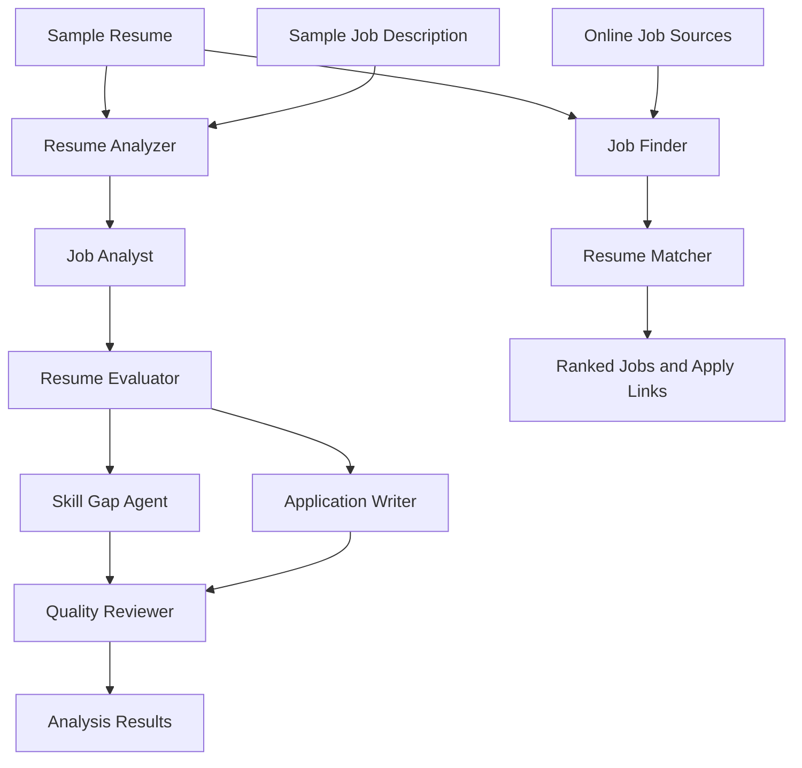

# AI Job Application Team

A simple multi-agent system that helps users analyze resumes, identify skill gaps, and find relevant job opportunities.

## Features

- **Resume Analyzer** — Compares a resume with a job description.
- **Skill Gap Analysis** — Identifies matched and missing skills.
- **Job Finder** — Retrieves job listings from online sources.
- **Match Score** — Estimates resume-to-job skill coverage.
- **Application Links** — Shows company names and links to apply.
- **AI Agents** — Work together to analyze job requirements and resumes.

## System Design

The project has two main workflows: resume analysis and job search.



## Tech Stack

| Tool | Purpose |
|---|---|
| Python | Main programming language |
| LangGraph | Manages the agent workflow |
| Google Gemini | Powers AI analysis |
| Pydantic | Validates structured data |
| UV | Manages dependencies |
| Pytest | Runs tests |

## Project Structure

```text
ai-job-application-team/
├── app/
│   ├── agents/
│   ├── graph.py
│   ├── models.py
│   ├── state.py
│   ├── llm.py
│   ├── config.py
│   ├── job_search.py
│   └── resume_matcher.py
├── data/
│   ├── sample_resume.md
│   └── sample_job.txt
├── tests/
├── output/
├── main.py
├── .env.example
├── .gitignore
└── pyproject.toml
```

## Getting Started

### 1. Install Dependencies

Install Python and UV, then run:

```bash
uv sync
```


### 2. Run the Resume Analyzer

```bash
uv run python main.py
```

The analyzer uses the sample resume and job description from the `data/` folder.

### 3. Run the Job Finder

```bash
uv run python -m app.job_search
```

The Job Finder retrieves available listings and ranks them against the sample resume.

## AI Agents

| Agent | Responsibility |
|---|---|
| Job Analyst | Extracts job requirements |
| Resume Evaluator | Compares the resume with the job |
| Skill Gap Agent | Identifies missing skills |
| Application Writer | Drafts tailored application content |
| Quality Reviewer | Reviews the final analysis |

LangGraph manages the workflow between the agents.

## Understanding Match Scores

The Job Finder currently uses keyword-based skill matching.

- **Matched skills:** Skills detected in both the resume and job listing.
- **Missing skills:** Skills detected in the job listing but not the resume.
- **Match score:** An estimate of skill coverage, not a guarantee of hiring success.

## Run Tests

```bash
uv run pytest
```

## Limitations

- Listings may be duplicated or expired.
- Some job sources may provide incomplete descriptions.
- Match scores may not reflect every job requirement.
- AI-generated suggestions should be reviewed before use.

## Project Goal

Build a practical multi-agent system that helps users understand their skill gaps and discover suitable job opportunities.
